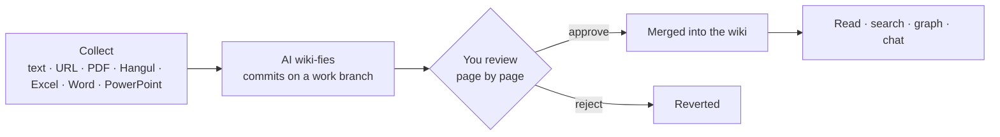

<p align="center">
  <picture>
    <source media="(prefers-color-scheme: dark)" srcset="docs/brand/lockups/2nd-brain-horizontal-dark.svg">
    
  </picture>
</p>

<h3 align="center">A personal wiki the AI writes and you approve</h3>

<p align="center">
  Drop in your material, the AI turns it into wiki pages, and you review them page by page.<br>
  A desktop app: no terminal, no git, no Obsidian setup.
</p>

<p align="center">
  <a href="LICENSE"></a>
  
  
  <a href="README.md"></a>
</p>

<p align="center">
  
  <br>
  <sub>The graph's <b>growth replay</b>: the wiki grows from one point to the whole, following its real links. (Captions in the clip are Korean.)</sub>
</p>

---

## What it is

Connect Claude or Codex, drop in material, and approve the pages the AI writes one by one. The wiki you end up with is
linked, drawn as a graph, and ready to search and ask about. The Korean [README](README.md) has the full feature reference.



- **No terminal.** The app installs the Claude or Codex CLI and walks you through sign-in. Nothing else to install first.
- **Your accounts, no server.** It runs on your own AI subscription and GitHub account; this project runs no server, subscription or billing.
- **The vault is a git repository.** Every change is a commit you can undo, and the vault keeps working in Obsidian without the app.
- **Only approved pages enter the wiki.** Wiki pages the AI makes need your approval. Your own notes and plans are written at once and can be undone any time.
- **Teams too.** One GitHub sign-in lets you push, pull and open review requests (PRs) against a team repository.
- **Korean and English** screens, switchable in settings.

## Screens

### Read and write

<p align="center">
  <picture>
    <source media="(prefers-color-scheme: dark)" srcset="docs/media/en-doc-dark.png">
    
  </picture>
</p>

File tree, document, chat. Documents are a live-preview editor, so you read and edit in one place, and hovering a `[[link]]` previews that page.
In the chat on the right you ask for things in plain words ("Create today's note"); answers land as files with an undo card.

### Find

<p align="center">
  
</p>

Keyword search (BM25, title-weighted, Korean partial matching) finds documents by content and files such as PDFs and images by name.

### Graph

<p align="center">
  
</p>

A 3D graph you can turn around. The more links a page has, the bigger and brighter it looks. Point at a node to keep only its neighbors; click it to open that page beside the graph.

> These screens use a sample vault of about 80 pages of AI-agent notes.

## Getting started

**Installers** — download the mac `.dmg` or the Windows `setup.exe` from [Releases](https://github.com/lemoncloud-io/2nd-brain-app/releases). The first run asks one question ("What do you want to organize?"), connects your AI and creates a vault. GitHub sign-in can wait.

**From source** — Node 22, pnpm 10.

```sh
pnpm install
pnpm dev
pnpm lint
pnpm test       # vitest
pnpm test:e2e   # build, then Playwright
pnpm build:mac  # mac arm64 dmg
```

Contributions: [CONTRIBUTING.md](CONTRIBUTING.md). Security reports: [SECURITY.md](SECURITY.md). Architecture notes are in [CLAUDE.md](CLAUDE.md), product assumptions in [PRODUCT.md](PRODUCT.md), design rules in [DESIGN.md](DESIGN.md), and past decisions in [`docs/decisions/`](docs/decisions) (Korean).

## License

[MIT](LICENSE)
