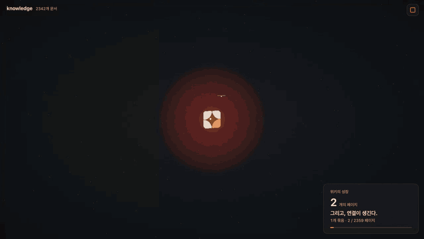
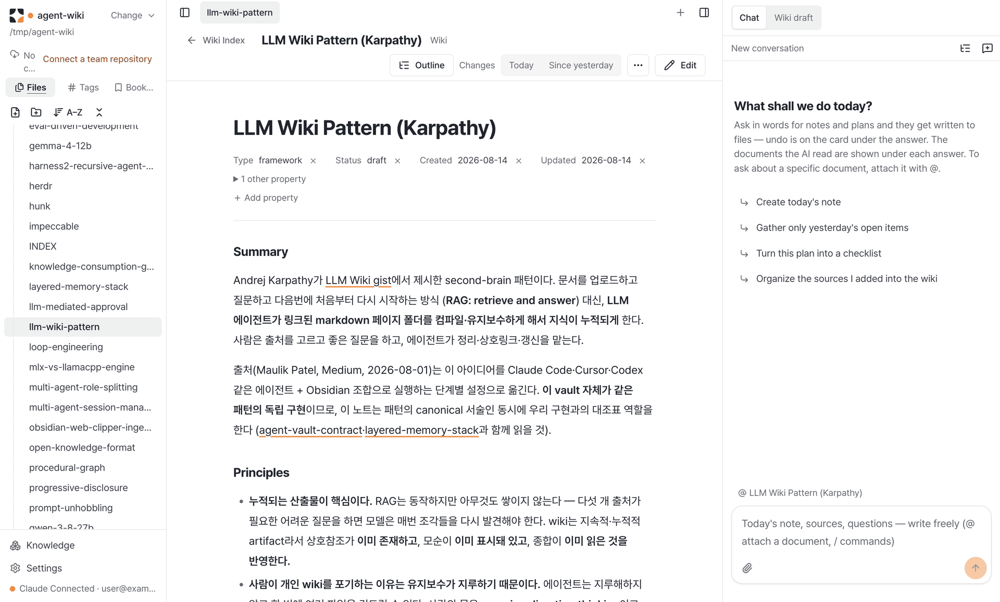
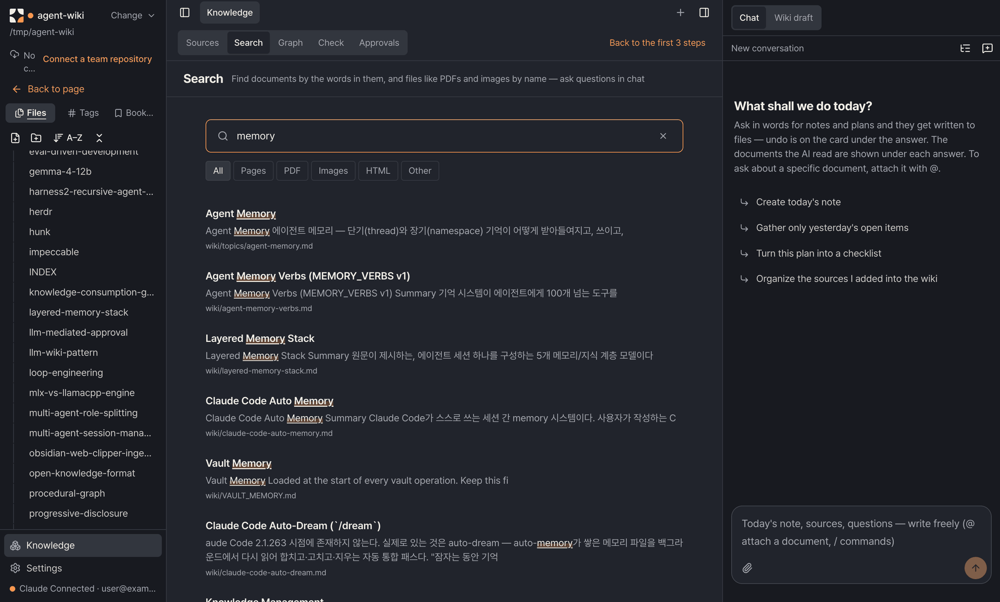
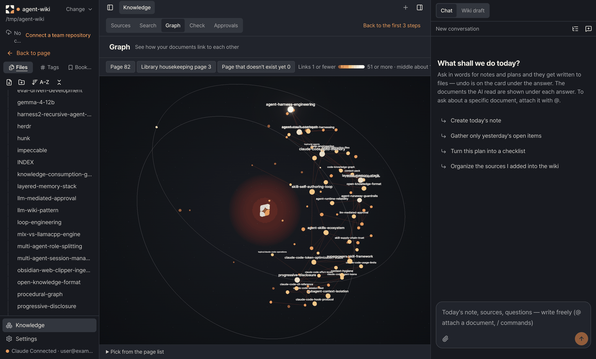

<p align="center">
  <b>Drop in your material, the AI turns it into wiki pages, and you review them page by page.</b><br>
  A desktop app: no terminal, no git, no Obsidian setup.
</p>

<p align="center">
  <a href="#screens">Screens</a> ·
  <a href="#features">Features</a> ·
  <a href="#getting-started">Getting started</a> ·
  <a href="#faq">FAQ</a>
</p>

<p align="center">
  <a href="LICENSE"></a>
  
  
  <a href="README.md"></a>
</p>

**2nd-brain turns what you read into a wiki the AI writes and you approve.** Connect Claude or Codex, drop in material,
and the AI writes linked wiki pages that you check one by one.

- **No terminal.** The app installs the Claude or Codex CLI and walks you through sign-in. Nothing else to install first.
- **Your accounts, no server.** It runs on your own AI subscription and GitHub account; this project runs no server, subscription or billing.
- **The vault is a git repository.** Every change is a commit you can undo, and the vault keeps working in Obsidian without the app.
- **Only approved pages enter the wiki.** Wiki pages the AI makes need your approval. Your own notes and plans are written at once and can be undone any time.
- **Teams too.** One GitHub sign-in lets you push, pull and open review requests (PRs) against a team repository.
- **Korean and English** screens, switchable in settings.

## Screens

<p align="center">
  
</p>
<p align="center"><sub>The graph's <b>growth replay</b>: the wiki grows from one point to the whole, following its real links. (Captions in the clip are Korean.)</sub></p>

### Read and write

<p align="center">
  <picture>
    <source media="(prefers-color-scheme: dark)" srcset="docs/media/en-doc-dark.png">
    
  </picture>
</p>

File tree, document, chat. Documents are a live-preview editor, so you read and edit in one place, and hovering a `[[link]]` previews that page.
In the chat on the right you ask for things in plain words ("Create today's note"); answers land as files with an undo card.

### Find and graph

<p align="center">
  
  
</p>
<p align="center"><sub>Keyword search with Korean partial matching · A 3D graph of linked pages</sub></p>

Search finds documents by content and files such as PDFs and images by name. In the graph, pages with more links look
bigger and brighter; click one to open it beside the graph.

> These screens use a sample vault of about 80 pages of AI-agent notes.

## Features

**Setup and vault**

- Five-step first run — what to organize, AI connection (the app installs and signs in the Claude Code or Codex CLI), GitHub sign-in, vault creation, push to GitHub
- The vault is a git repository — every change is a commit; each document has history, diff and restore
- Open an existing Obsidian folder as is, or turn it into a vault without touching your files

**Material and wiki-fying**

- Add material — text, URLs, PDF, Hangul (hwp, hwpx), Word, Excel and PowerPoint become text; clip the page open in a web tab
- Wiki-fy — the AI drafts wiki pages on a work branch; only pages you read and approve enter the wiki
- Check — structure checks plus an AI review (contradictions, stale content, missing pages, duplicates), and merging two duplicate pages

**Read and write**

- Live-preview editor — `[[` autocomplete, templates, image paste, AI rewrite of a selection
- Link previews, backlinks and broken links under each page
- Tabs, split view, web tabs, tags and bookmarks (same file as Obsidian), ⌘K and ⌘P
- Today note — open items from earlier notes and today's to-dos in one line
- Previews for images, PDF, audio, video, Word, PowerPoint and Obsidian Bases

**Find and graph**

- Keyword search (BM25) with Korean partial matching, filtered by tag or file type
- 3D link graph with a growth replay

**Chat**

- Always open on the right (⌘J); one AI session per conversation keeps the context
- Attach documents with `@`, paste images, read GitHub PRs, issues and web pages, run `/` skills and MCP servers
- Files an answer writes get a card to review and undo hunk by hunk; out-of-scope tools ask for approval

**Teams**

- One GitHub sign-in to create a team vault, invite people and join
- Change alerts with one-click pull; your edits go out as review requests (PRs), or straight to a repository only you use
- Never pushes to a public repository

**Also**

- Korean and English screens, light and dark themes, app updates, local-only diagnostic logs and export

## Getting started

**Installers** — download the mac `.dmg` or the Windows `setup.exe` from [Releases](https://github.com/lemoncloud-io/2nd-brain-app/releases). The first run asks one question ("What do you want to organize?"), connects your AI and creates a vault. GitHub sign-in can wait.

**From source** — Node 22, pnpm 10.

```sh
pnpm install
pnpm dev
pnpm lint
pnpm test       # vitest
pnpm test:e2e   # build, then Playwright
pnpm build:mac  # mac arm64 dmg
```

Contributions: [CONTRIBUTING.md](CONTRIBUTING.md). Security reports: [SECURITY.md](SECURITY.md). Architecture notes are in [CLAUDE.md](CLAUDE.md), product assumptions in [PRODUCT.md](PRODUCT.md), design rules in [DESIGN.md](DESIGN.md), and past decisions in [`docs/decisions/`](docs/decisions) (Korean).

## FAQ

<details>
<summary><b>Is it free?</b></summary>

The app is open source under the MIT license. The AI runs on your own Claude or Codex account; this project charges no subscription.

</details>

<details>
<summary><b>Where does my data live?</b></summary>

The vault is a folder (a git repository) on your computer. This project has no server. The only things that leave your
machine are the questions and documents sent to your AI program, and the vault if you choose to push it to GitHub. It never pushes to a public repository.

</details>

<details>
<summary><b>What if the AI gets a page wrong?</b></summary>

Wiki-fying runs in a separate workspace, and only pages you approve enter the wiki. Rejected pages go back to how they
were, and you can undo right after merging. Every change is a commit, so a document's history can take you back to any earlier version.

</details>

<details>
<summary><b>Do I need Obsidian?</b></summary>

No. Reading, writing and search all happen in the app. The vault is a plain Markdown folder, so it also opens in Obsidian,
and you can open an existing Obsidian folder in the app.

</details>

<details>
<summary><b>Which computers does it run on?</b></summary>

Apple Silicon Macs (arm64) and Windows x64. There are no Intel Mac or Linux installers.

</details>

## License

[MIT](LICENSE)
