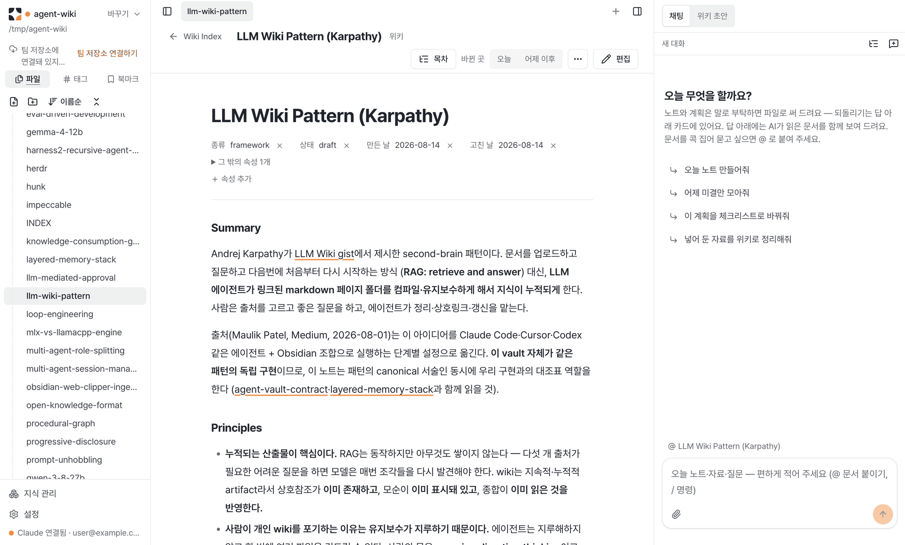
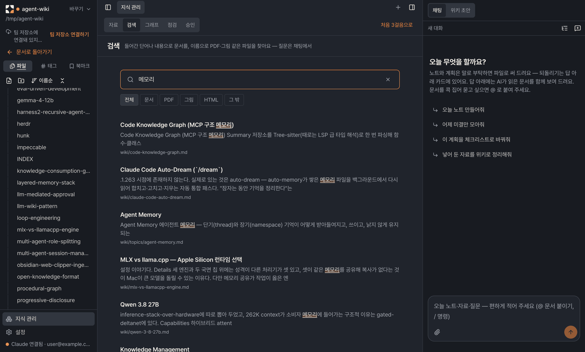
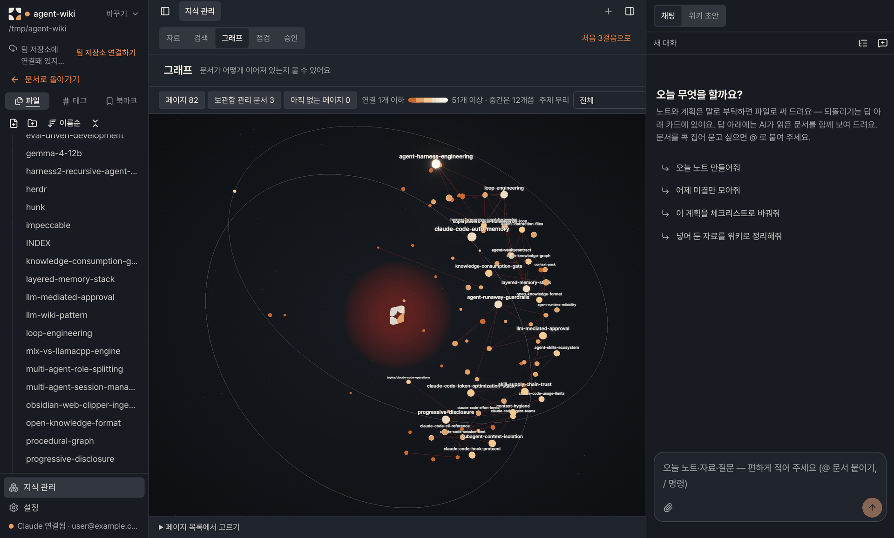

<p align="center">
  <picture>
    <source media="(prefers-color-scheme: dark)" srcset="docs/brand/lockups/2nd-brain-horizontal-dark.svg">
    
  </picture>
</p>

<h3 align="center">AI가 쓰고, 사람이 승인하는 개인 위키</h3>

<p align="center">
  자료를 모으면 AI가 위키로 정리하고, 사람은 페이지마다 확인만 합니다.<br>
  터미널도, git도, Obsidian 설정도 필요 없는 데스크톱 앱.
</p>

<p align="center">
  <a href="LICENSE"></a>
  
  
  <a href="README.en.md"></a>
</p>

<p align="center">
  
  <br>
  <sub>그래프의 <b>성장 재생</b> — 위키가 실제 링크를 따라 한 점에서 전체로 자랍니다.</sub>
</p>

---

## 이런 앱이에요

Claude 또는 Codex 를 연결하고, 자료를 끌어다 놓고, AI가 정리한 페이지를 하나씩 **승인**하면 개인 위키가 쌓입니다.
위키는 링크로 이어져 그래프로 보이고, 검색과 채팅으로 바로 꺼내 쓸 수 있어요.


- **터미널 없이.** Claude·Codex CLI 는 앱이 직접 설치하고 로그인까지 이어 줍니다. 다른 선행 설치가 없어요.
- **내 계정, 서버 없음.** 내 AI 구독과 GitHub 계정으로 돌고, 이 프로젝트는 서버·구독·결제를 두지 않습니다.
- **보관함은 git 저장소.** 모든 변경이 커밋이라 언제든 되돌릴 수 있고, 앱 없이 Obsidian 으로 열어도 그대로 동작합니다.
- **위키는 승인한 것만.** AI가 만든 위키 페이지는 사람이 승인해야 들어갑니다. 내 노트·계획은 바로 쓰이고, 언제든 되돌릴 수 있어요.
- **팀으로도.** GitHub 로그인 하나로 팀 저장소에 올리고, 받고, 확인 요청(PR)을 엽니다.
- **한국어 · English.** 화면 언어를 설정에서 바꿀 수 있어요.

## 화면

### 읽고 쓰기

<p align="center">
  <picture>
    <source media="(prefers-color-scheme: dark)" srcset="docs/media/ko-doc-dark.png">
    
  </picture>
</p>

왼쪽 파일 트리, 가운데 문서, 오른쪽 채팅 칸. 문서는 읽으면서 바로 고치는 라이브 미리보기 편집기이고, `[[링크]]` 는 마우스를 올리면 그 페이지 앞부분이 곁에 뜹니다.
오른쪽 채팅에는 "오늘 노트 만들어줘" 처럼 말로 일을 시킵니다. 답은 되돌리기 카드와 함께 파일로 남아요.

### 찾기

<p align="center">
  
</p>

키워드 검색(BM25, 제목 가중, 한글 부분 일치)은 문서를 내용으로, PDF·그림 같은 파일을 이름으로 찾습니다.

### 그래프

<p align="center">
  
</p>

링크로 이어진 페이지를 돌려 볼 수 있는 3D 그래프. 많이 이어진 페이지일수록 크고 밝게 보이고, 점을 짚으면 이웃만 남기고, 누르면 그 페이지를 옆 칸에 엽니다.

> 위 화면은 AI 에이전트 운영 노트 80여 쪽으로 만든 예시 보관함입니다.

## 시작하기

**설치본으로** — [Releases](https://github.com/lemoncloud-io/2nd-brain-app/releases) 에서 mac(`.dmg`) 또는 Windows(`setup.exe`)를 받아 설치하세요. 첫 실행은 질문 하나("무엇을 정리하고 싶으세요?"), AI 연결, 보관함 만들기 순으로 안내합니다. GitHub 로그인은 나중에 해도 돼요. 자세한 설치·삭제는 [아래](#설치와-삭제).

**소스에서** — Node 22, pnpm 10.

```sh
pnpm install
pnpm dev
```

기여는 [CONTRIBUTING.md](CONTRIBUTING.md), 취약점 제보는 [SECURITY.md](SECURITY.md). 사용자·제품 전제는 [PRODUCT.md](PRODUCT.md), 화면 설계는 [DESIGN.md](DESIGN.md), 설계 결정 기록은 [`docs/decisions/`](docs/decisions).

## 기능

**시작과 보관함**

- 첫 실행 다섯 단계 안내 — 무엇을 정리할지, AI 연결(Claude Code·Codex CLI 설치와 로그인을 앱이 대신), GitHub 로그인, 보관함 만들기, GitHub에 올리기
- 보관함은 git 저장소 — 모든 변경이 커밋으로 남고, 문서마다 기록 보기·비교·되돌리기
- 쓰던 Obsidian 폴더를 그대로 열거나, 있던 파일은 건드리지 않고 보관함으로 바꾸기

**자료와 위키화**

- 자료 넣기 — 글·URL·PDF·한글(hwp·hwpx)·워드·엑셀·파워포인트를 글로 바꿔 보관, 웹 탭에서 보던 페이지 바로 담기
- 위키화 — AI 가 작업 브랜치에 위키 초안을 쓰고, 사람이 페이지마다 읽고 승인한 것만 위키에 들어간다
- 점검 — 구조 검사와 AI 점검(모순·오래된 내용·빠진 페이지·같은 내용), 같은 내용 두 페이지 합치기

**읽고 쓰기**

- 라이브 미리보기 편집기 — `[[` 자동완성, 템플릿, 그림 붙여넣기, 고른 글을 AI 로 고치기
- 링크 미리보기, 여기를 가리키는 페이지·끊긴 링크 모음
- 탭·좌우 분할·웹 탭, 태그·북마크(Obsidian 과 같은 파일), ⌘K·⌘P 단축키
- 오늘 노트 — 지난 노트에 남은 일과 오늘 할 일을 한 줄로
- 그림·PDF·소리·영상·워드·파워포인트·Obsidian Bases 미리보기

**찾기와 그래프**

- 한글 부분 일치 키워드 검색(BM25), 태그·파일 종류로 거르기
- 3D 링크 그래프와 성장 재생

**채팅**

- 오른쪽 칸에 늘 열려 있다(⌘J). 대화마다 AI 세션을 켜 두어 앞 대화를 기억한다
- `@` 로 문서 붙이기, 그림 붙여넣기, GitHub PR·이슈·웹 주소 읽기, `/` 스킬, MCP 서버
- 답이 쓴 파일은 카드에서 검토하고 곳마다 되돌리기, 범위 밖 도구는 승인 카드로 묻기

**팀**

- GitHub 로그인 하나로 팀 보관함 만들기·초대·들어가기
- 팀 변경 알림과 한 번에 받기, 내 수정은 확인 요청(PR)으로 — 혼자 쓰는 저장소는 바로 올린다
- 공개 저장소에는 올리지 않는다

**그 밖**

- 한국어·영어 화면, 라이트·다크 테마, 앱 업데이트, 이 컴퓨터에만 남는 진단 기록과 내보내기

## 설치와 삭제

테스트용 비서명 빌드다 — 첫 실행은 mac 에서 `xattr -dr com.apple.quarantine "/Applications/2nd-brain.app"`
(또는 차단 뒤 시스템 설정 → 개인정보 보호 및 보안 → "그래도 열기"; 우클릭 → 열기는 macOS 15 미만에서만), Windows 에서
SmartScreen "추가 정보 → 실행" 이 필요하다. Claude·Codex CLI 는 설치본에 없고 첫 화면의 "설치" 버튼이 깐다.

- **mac**: dmg 의 앱을 `/Applications` 로. 삭제는 dmg 루트(또는 앱 안 `Contents/Resources`)의
  `Uninstall 2nd-brain.command` 를 터미널에서 `bash "<경로>"` 로 — 앱·앱 데이터·앱이 깐 CLI 를 확인 뒤 지운다
  (`--yes` 묻지 않음 · `--check` 지우지 않고 남은 것만 세기).
- **Windows**: `setup.exe`(per-user, 관리자 권한 없음). 삭제는 프로그램 추가/제거 또는 설치 폴더의
  `Uninstall 2nd-brain.exe` — 앱이 깐 CLI 가 있으면 같이 지울지 한 번 묻는다. 무인은 `/S`.
- **예전 이름(2nd-brain Desktop·eureka-wiki)으로 깐 경우**: 설정·대화·로그인은 그대로 이어진다(앱 데이터 폴더는 이름과 무관하게
  `2nd-brain-app`). 보관함 기록의 옛 이름 커밋도 계속 앱이 만든 것으로 보인다. mac 은 새 `2nd-brain.app` 이 옛
  `2nd-brain Desktop.app`·`eureka-wiki.app` 옆에 따로 깔리므로 옛 앱은 직접 휴지통으로 —
  옛 언인스톨러를 돌리면 앱 데이터까지 지운다. Windows 는 appId·설치 폴더(`2nd-brain-app`)가 같아 기존 설치를 바꿀 것으로
  본다 — 미검증, 첫 교체 설치 때 옛 바로 가기가 남는지 확인한다.

지우는 경로의 정본은 `build/uninstall-targets.json`, 절차·우회·수동 매트릭스·알려진 잔여물은 `docs/INSTALL-TEST.md`.
볼트 폴더와 앱이 깔지 않은 CLI·설정은 어떤 경로에서도 건드리지 않는다.

## 개발

```sh
pnpm install
pnpm dev        # 개발 창
pnpm test       # vitest
pnpm test:e2e   # build 후 Playwright (e2e/**/*.spec.ts)
pnpm build:mac  # mac arm64 dmg — ad-hoc 서명
pnpm build:win  # Windows 에서만(mac 크로스 빌드는 mac 용 git 을 번들한다) — CI installer 워크플로가 만든다
```

e2e 는 테스트마다 앱을 띄운다. 앱과 임시 폴더의 뒷정리는 spec 이 아니라 `e2e/fixtures.ts` 의 `launch`
fixture 가 한다 — 단언이 깨지거나 시간 초과로 끊겨도 닫고 지운다. 임시 폴더는 실행마다 한 그루
(`$TMPDIR/2nd-brain-e2e/<runId>`)라 `globalTeardown` 이 통째로 걷고, 하루 넘은 옛 그루는 다음 실행이
걷는다. 앱을 띄우는 spec 은 `@playwright/test` 대신 `./fixtures` 에서 `test` 를 가져온다.
`pnpm test:e2e:stray` 는 스위트가 끝난 뒤 남은 앱 프로세스를 센다(0 이어야 한다).

CI(`.github/workflows/ci.yml`)는 main 으로 가는 PR 과 main push 마다 macOS 러너 하나에서 build(typecheck 포함)·lint·
vitest·e2e(실패 spec 한 번 재시도)·남은 앱 프로세스 0 을 본다. Windows 는 아직 없다 — 설치본 스모크(`installer.yml`)만 돈다.
`e2e/perf-vault.spec.ts` 는 240쪽 합성 볼트에서 열기·편집·태그·언급·검색이 한 동작 2초(점검 10초) 안인지 잰다.
`KNOWLEDGE_VAULT=<볼트 경로>` 를 주면 그 볼트의 로컬 복제(`git clone --local`)로 잰다 — 원본은 열지 않는다.

앱은 사용자 PC 의 git·Python 을 쓰지 않는다. git 은 `dugite` 번들, 병합 전 검증은 vault-kit 의
`vault_verify.py`·`vault_volume.py` 를 옮긴 `src/main/verify/` 다. `pnpm test` 의 대조 테스트
(`vault-verify.test.ts`)만 개발 PC 의 `python3` 로 원본을 같이 돌려 판정이 같은지 본다.
